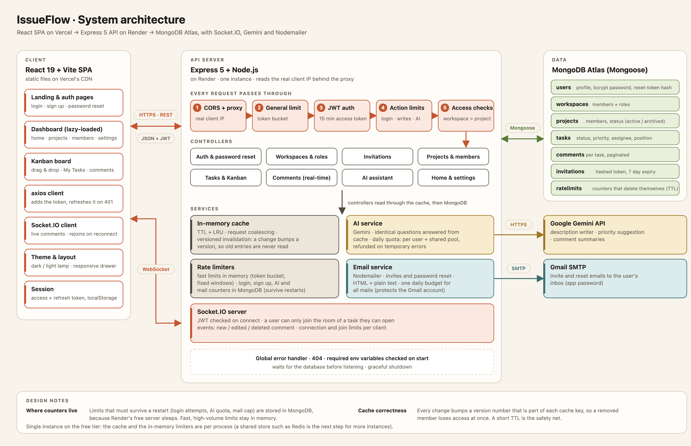

# IssueFlow

**IssueFlow** is a full-stack project management platform for teams. It combines workspaces with role-based access, Kanban boards, real-time comments and an AI assistant, on a backend built to run on free hosting: rate limited, cached and secured.

      

## Contents

- [Features](#features)
- [Architecture](#architecture)
- [Tech stack](#tech-stack)
- [Project structure](#project-structure)
- [Getting started](#getting-started)
- [Environment variables](#environment-variables)
- [API reference](#api-reference)
- [Rate limiting](#rate-limiting)
- [Caching](#caching)
- [Performance](#performance)
- [Security](#security)
- [Deployment](#deployment)
- [Scripts](#scripts)
- [Known limitations](#known-limitations)
- [Author](#author)

---

## Features

### Accounts and security
- Register, log in and log out, with a short-lived **access token (15 minutes)** and a **refresh token (7 days)** stored on the server. The frontend renews the access token silently and retries the failed request, so users stay signed in for a week.
- **Forgot / reset password** by email: a one-hour, single-use link. Only a hash of the token is stored, the answer is the same whether or not the account exists, and a reset signs out every device.
- Logged-in users are taken straight from the home page to their dashboard.
- Emails are case-insensitive, so one person has one account.

### Workspaces, roles and invitations
- Multiple workspaces per user, with **admin** and **member** roles.
- Admins invite people **by email** (Nodemailer, HTML and plain-text versions). Invite links are secret, hashed in the database, valid for 7 days and usable once. Admins can see and cancel pending invites.
- Invited users who are not logged in are sent through login or sign-up and returned to the invite automatically.
- Promote members, remove members, leave a workspace, rename it or delete it. Deleting a workspace deletes everything inside it.

### Projects
- Projects live inside a workspace and have their own members and roles (**project admin** and **member**).
- Admins see every project, members see only the projects they belong to.
- **Archive** a project to make it read-only (tasks and comments cannot change) and unarchive it later. Archived projects can be deleted, which removes their tasks and comments.
- Project overview with task statistics, member management and settings.

### Tasks and Kanban
- Kanban board with **To do, In progress and Done** columns and **drag and drop** (`@hello-pangea/dnd`). Moves are optimistic and roll back if the server refuses them.
- Positions are stored as numbers between neighbours, and a column is renumbered automatically when the gaps get too small.
- Priority (low, medium, high), assignee (project members only), title and description. Create a task straight into a column with the column's `+` button.
- **My Tasks** board with every task assigned to you in the workspace.
- Task detail window with the full task and its comments.

### Real-time comments
- Comments are added, edited and deleted live for everyone viewing the task (**Socket.IO**, one room per task).
- Sockets require a valid token, and a user can only join the room of a task they are allowed to open.
- Comments are paginated, and only the author can edit or delete a comment.

### AI assistant (Google Gemini)
- **Generate a task description** from a title, **suggest a priority**, and **summarize a task's comments**.
- The free Gemini key has a small daily limit, so the app manages it: a shared daily pool plus a per-user allowance, refunds on temporary errors, and a "uses left today" counter in the task form.
- Identical questions are answered from a cache and cost no quota.

### Dashboard and experience
- Home page with a time-of-day greeting, a progress ring, animated counters, recent projects and your latest tasks.
- **Dark and light themes** (warm charcoal with a terracotta accent), switched with a hanging lamp on the home page and remembered between visits.
- Responsive dashboard and sign-in pages: the sidebar becomes a drawer on phones and tablets, tables and boards scroll sideways.
- Landing page, loading skeletons, toast messages, and code-splitting so each page loads only what it needs.

### Platform
- **Rate limiting** with a different algorithm and store for each kind of endpoint (see [Rate limiting](#rate-limiting)).
- **In-memory caching** with TTL, LRU eviction, request coalescing and instant invalidation (see [Caching](#caching)).
- Consistent input validation (clear 400 errors instead of 500s), a global error handler, startup checks for required settings and graceful shutdown.
- Cascade deletes, so removing a task, project or workspace leaves no orphaned data.

---

## Architecture



**Request lifecycle.** Every API request passes through the same pipeline: CORS and proxy handling (so the real client IP is known), a general token-bucket limit, JWT verification, the limits for that kind of action, and the access checks (workspace, then project, then task). Allowed requests reach a controller, which reads through the in-memory cache and falls back to MongoDB.

**Data model** (MongoDB, Mongoose):

| Collection | Holds |
|---|---|
| `users` | name, email (lowercase, unique), bcrypt password, role, refresh token, reset-token hash and expiry |
| `workspaces` | name, creator, members with roles |
| `projects` | workspace, name (unique per workspace), description, members with roles, status (active or archived) |
| `tasks` | title, description, project, workspace, creator, assignee, status, priority, position |
| `comments` | task, author, text, edited flag |
| `invitations` | workspace, email, role, hashed token, status, expiry (one pending invite per workspace and email) |
| `ratelimits` | counters for the limits that must survive restarts, removed automatically by a TTL index |

---

## Tech stack

| Area | Technology |
|---|---|
| Frontend | React 19, Vite 7, React Router 7, Tailwind CSS 4, Framer Motion, `@hello-pangea/dnd`, Axios, `react-hot-toast`, Lucide icons, `react-countup` |
| Backend | Node.js, Express 5, Mongoose 9, JSON Web Tokens, bcrypt |
| Real time | Socket.IO 4 |
| Database | MongoDB (Atlas in production) |
| Email | Nodemailer with Gmail SMTP |
| AI | Google Gemini (`@google/genai`) |
| Hosting | Vercel (frontend), Render (backend), MongoDB Atlas (database) |

---

## Project structure

```
IssueFlow-AI/
├── architecture.png
├── client-frontend/
│   ├── configs/api.js              # axios client: sends the token, refreshes it on 401
│   └── src/
│       ├── page/                   # Home, Login, Register, Forgot/Reset password, Invite, Dashboard shell
│       ├── components/
│       │   ├── Dashboard/          # Home, My Tasks, Projects, Members, Settings
│       │   ├── KanbanBoard/        # board, add / edit / detail task windows, shared styles
│       │   ├── SingleProject.jsx/  # project overview, tasks, members, settings
│       │   ├── Comments/           # live comments
│       │   └── ThemeLamp.jsx       # the dark / light lamp
│       ├── socket.js               # authenticated Socket.IO client
│       └── index.css               # Tailwind + the dark / light theme
└── server-backend/
    ├── server.js                   # app setup, startup checks, graceful shutdown
    ├── config/                     # database, rate limit numbers
    ├── routes/                     # one file per area
    ├── controllers/                # request handlers
    ├── authMiddleWare/             # JWT, workspace / project / task access, rate limit middleware
    ├── services/                   # email, AI + AI quota, cache helpers, rate limiters, sockets
    ├── models/                     # Mongoose schemas
    ├── utils/                      # cache, limiter algorithms, error helper
    ├── template/                   # email templates
    └── scripts/                    # benchmark, orphan cleanup
```

---

## Getting started

### Prerequisites
- Node.js **20.19 or newer** (or 22.12+)
- A MongoDB database: a free [MongoDB Atlas](https://www.mongodb.com/atlas) cluster, or MongoDB running locally
- *(optional)* a Gmail account with an [app password](https://support.google.com/accounts/answer/185833), to send invite and password-reset emails
- *(optional)* a [Gemini API key](https://aistudio.google.com/apikey), for the AI features

### 1. Backend
```bash
cd server-backend
npm install
cp .env.example .env      # then fill in the values (see below)
npm run dev               # http://localhost:7001
```

### 2. Frontend
```bash
cd client-frontend
npm install
cp .env.example .env      # VITE_BASE_URL=http://localhost:7001
npm run dev               # http://localhost:5173
```

### 3. Production build of the frontend
```bash
npm run build             # output in client-frontend/dist
```

The server refuses to start without `MONGO_URI`, `JWT_SECRET` and `JWT_REFRESH_SECRET`, and prints which settings are missing.

---

## Environment variables

### Backend (`server-backend/.env`)

| Variable | Required | Purpose |
|---|---|---|
| `MONGO_URI` | yes | MongoDB connection string |
| `JWT_SECRET` | yes | signs access tokens (`openssl rand -hex 32`) |
| `JWT_REFRESH_SECRET` | yes | signs refresh tokens, must differ from `JWT_SECRET` |
| `PORT` | no | server port (default 7001, hosts usually set it) |
| `HOST` | yes in production | frontend origin allowed by Socket.IO CORS, no trailing slash |
| `CLIENT_URL` | yes in production | frontend URL used in invite and reset links, no trailing slash |
| `EMAIL_USER`, `GOOGLE_APP_PASSWORD` | for email | Gmail account and app password used by Nodemailer |
| `GEMINI_API_KEY` | for AI | Google Gemini key |
| `GEMINI_MODEL` | no | model name (default `gemini-3.1-flash-lite`) |
| `TRUST_PROXY` | no | number of proxies in front of the server (default 1, which is right for Render) |
| `AI_DAILY_LIMIT` | no | AI requests per day for the whole app, set it to your key's limit (default 20) |
| `AI_USER_DAILY_LIMIT` | no | AI requests per user per day (default 3) |
| `MAIL_DAILY_LIMIT` | no | emails per day for the whole app (default 300) |
| `CACHE_ENABLED` | no | set to `false` to switch the cache off (default on) |
| `RATE_GENERAL_BURST`, `RATE_GENERAL_PER_MINUTE` | no | size and refill speed of the general rate limit bucket (default 100 and 300) |

### Frontend (`client-frontend/.env`)

| Variable | Purpose |
|---|---|
| `VITE_BASE_URL` | URL of the backend, used by Axios and Socket.IO. Vite reads it at build time, so redeploy after changing it. |

---

## API reference

Base path `/api`. All routes except those marked *public* need `Authorization: Bearer <access token>`. Errors are JSON with a `message`.

| Area | Method and path | Purpose |
|---|---|---|
| **Auth** | `POST /users/register` | create an account (*public*) |
| | `POST /users/login` | log in, returns access and refresh token (*public*) |
| | `POST /users/refresh` | new access token from a refresh token (*public*) |
| | `POST /users/logout` | invalidate the refresh token (*public*) |
| | `POST /users/forgot-password` | email a reset link (*public*) |
| | `POST /users/reset-password/:token` | set a new password (*public*) |
| **Workspaces** | `POST /workspace`, `GET /workspaces`, `GET /workspace/:id` | create, list mine, read one |
| | `GET /workspace/:id/details` | user and workspace details |
| | `PATCH /workspace/:id/settings/user`, `.../settings/workspace` | rename yourself, rename the workspace (admin) |
| | `DELETE /workspace/:id/me`, `DELETE /workspace/:id/remove` | leave, delete (admin) |
| | `GET /workspace/:id/home` | dashboard statistics |
| **Members and invites** | `GET /workspace/:id/members` | list members |
| | `POST /workspace/:id/invite` | email an invitation (admin) |
| | `GET /workspace/:id/invites`, `DELETE /workspace/:id/invite/:inviteId` | pending invites, cancel (admin) |
| | `GET /invite/:token` | check an invite link (*public*) |
| | `POST /invite/accept/:token` | accept an invitation |
| | `PATCH /workspace/:id/member/:memberId/promote`, `DELETE .../member/:memberId` | promote, remove (admin) |
| **Projects** | `POST /workspace/:id/projects`, `GET /workspace/:id/projects` | create (admin), list |
| | `GET /projects/:projectId`, `PATCH /projects/:projectId`, `DELETE /projects/:projectId` | read, edit, delete (archived only) |
| | `PATCH /projects/:projectId/archive` | archive or unarchive |
| | `POST /projects/:projectId/members`, `PATCH` and `DELETE /projects/:projectId/members/:memberId` | add, change role, remove |
| **Tasks** | `GET` and `POST /workspace/:id/projects/:projectId/tasks` | list, create |
| | `GET`, `PATCH`, `DELETE .../tasks/:taskId` | read, edit, delete |
| | `PATCH .../tasks/:taskId/move` | change column and position |
| | `GET /workspace/:id/tasks`, `PATCH /workspace/:id/tasks/:taskId/move` | My Tasks, move from My Tasks |
| **Comments** | `GET` and `POST /workspace/:id/project/:projectId/task/:taskId/comments` | list (paginated), add |
| | `PATCH .../comments/:commentId/edit`, `DELETE .../comments/:commentId/delete` | edit, delete (author only) |
| **AI** | `GET /ai/quota` | AI uses left today |
| | `POST /ai/generate-description`, `/ai/suggest-priority`, `/ai/summarize-comments` | AI helpers |

Real-time events (Socket.IO, authenticated on connect): the client sends `joinTask` and `leaveTask`, and receives `newComment`, `editComment` and `deleteComment`.

---

## Rate limiting

Counters that must survive a restart live in MongoDB (Render's free server sleeps and restarts). Fast, high-volume limits stay in memory. When a limit is hit the API answers `429` with `Retry-After` and `RateLimit-*` headers, and the frontend shows the message. If the counter store itself fails, requests are allowed, so a broken counter never takes the site down. All numbers are in `server-backend/config/rateLimits.js`.

| Protection | Key | Limit | Algorithm | Store |
|---|---|---|---|---|
| Whole API | user, or IP when logged out | burst of 100, then 300 per minute | token bucket | memory |
| Create, edit, delete, move | user | 60 per minute | fixed window | memory |
| Login (failed attempts only) | IP + email, and IP | 5 and 30 per 15 min | fixed window | MongoDB |
| Sign up | IP | 5 per hour | fixed window | MongoDB |
| Forgot password | email, and IP | 3 and 10 per hour | fixed window | MongoDB |
| Reset password, token refresh | IP | 10 and 30 per 15 min | fixed window | MongoDB |
| AI burst | user | 5 per minute | fixed window | memory |
| AI daily quota | user, and the whole app | 3 per user, 20 per day total | daily window (Pacific time, like Google) | MongoDB |
| Invitations | workspace, and recipient | 20 per hour, 3 per day | fixed window | MongoDB |
| All outgoing email | whole app | 300 per day | daily window | MongoDB |
| Sockets | IP, and socket | 20 connections and 30 joins per minute | fixed window | memory |

The server reads the real client IP from the proxy (`TRUST_PROXY`), and logs the IP it sees on the first request so the setting can be checked after deployment.

---

## Caching

An in-memory cache (`server-backend/utils/cache.js`, about 70 lines) removes repeated database reads.

- **TTL and LRU:** every entry expires after 30 to 60 seconds, and at most 300 entries are kept (the least recently used is dropped first).
- **Request coalescing:** if many requests ask for the same missing item at once, one database query runs and they share the answer.
- **Versioned invalidation:** each group of data has a version number that is part of every cache key. A change adds 1 to the version, so old entries are never read again. Removed members and archived projects take effect on the very next request.
- **Cache only successes:** errors, missing data and denied access are never cached, and cached data is read-only.

| Cached | TTL | Cleared when |
|---|---|---|
| Workspace and project lookups (the access check on almost every request) | 60 s | members, roles, project or archive status change |
| Task lists and My Tasks | 30 s | a task is created, edited, moved or deleted |
| Project lists | 30 s | a project or its members change |
| Workspace list and user details | 60 s | someone joins, leaves, renames, or changes their name |
| AI answers (keyed by the prompt) | 24 h | not needed, a changed prompt is a new key |

Set `CACHE_ENABLED=false` to switch the cache off, for example to measure it.

---

## Performance

Measured with `server-backend/scripts/benchmark.js` (latency of each endpoint and of whole pages) and [autocannon](https://github.com/mcollina/autocannon) (load), on a workspace with 2 projects and 40 tasks. Each number is the median of 3 runs of 20 rounds.

Because a local database answers in under a millisecond and a free Atlas cluster does not, everything was run twice: with **no database delay** and with **25 ms added to every query** to approximate a remote cluster. All three setups used the same database, data and machine.

- **Baseline:** the original implementation, without the cache and the rate limiter (commit `cf338d5`)
- **Cache off:** the current code with `CACHE_ENABLED=false`
- **Cache on:** the current code with the default settings

### Latency per endpoint (median, milliseconds)

| Endpoint | Baseline | Cache off | Cache on | Speed-up, no DB delay | Speed-up, 25 ms per query |
|---|---|---|---|---|---|
| Task list (board) | 1.9 / 113 | 1.6 / 112 | **0.5 / 2.1** | 3.8x | 54x |
| My Tasks | 1.6 / 112 | 1.5 / 111 | **0.4 / 1.0** | 4.0x | 112x |
| Project list | 0.8 / 56 | 0.8 / 56 | **0.4 / 1.3** | 2.0x | 43x |
| Workspace list (sidebar) | 0.5 / 28 | 0.6 / 29 | **0.4 / 0.9** | 1.2x | 31x |
| Details | 0.9 / 83 | 1.0 / 83 | **0.4 / 0.9** | 2.2x | 92x |
| Home statistics (not cached) | 1.7 / 138 | 1.8 / 139 | 1.8 / 111 | 0.9x | 1.2x |
| Members (not cached) | 0.8 / 55 | 0.8 / 56 | 0.9 / 56 | 0.9x | 1.0x |
| Project page (not cached) | 1.0 / 82 | 1.0 / 83 | 1.2 / 83 | 0.8x | 1.0x |
| **Open the Home page** (3 requests together) | 2.0 / 139 | 2.2 / 140 | 2.3 / 113 | 0.9x | 1.2x |
| **Open a Board page** (5 requests together) | 2.6 / 115 | 2.6 / 113 | 1.7 / 84 | 1.5x | 1.4x |

Each cell shows the time with no database delay, then with 25 ms per query. Speed-up is Baseline divided by Cache on.

### Database queries per request (second request)

| Endpoint | Baseline | Cache on |
|---|---|---|
| Task list | 5 | **0** |
| My Tasks | 5 | **0** |
| Project list | 2 | **0** |
| Details | 3 | **0** |
| Home statistics | 11 | 10 |
| Members, project page | 2, 4 | 2, 4 |

### Load test (10 connections, 8 seconds)

| Endpoint | Baseline | Cache off | Cache on |
|---|---|---|---|
| Task list, requests per second, no DB delay | 1,326 | 2,131 | **7,912** |
| Task list, requests per second, 25 ms per query | 90 | 90 | **7,782** |
| Task list, average latency, 25 ms per query | 110 ms | 110 ms | **1.1 ms** |
| Workspace list, requests per second, 25 ms per query | 330 | 350 | **21,528** |

### How to read these numbers
- **The database delay is simulated.** Real gains depend on the distance between the server and the database. Keep Render and Atlas in the same region.
- **This is the best case for the cache.** The run finishes inside the cache lifetime, so almost every cached request is a hit.
- **Cache off is already faster than the baseline under load**, because lists now return plain objects (`.lean()`) and the access check is leaner.
- **Page loads improve less than single endpoints**, because home statistics, members and the project page are not cached yet.
- The tools and servers shared one computer, so only compare numbers within this table. These are API measurements; frontend load time and a real Render and Atlas deployment were not measured.

### Reproduce
```bash
cd server-backend
CACHE_ENABLED=false npm run dev      # or leave the variable out for "cache on"
node scripts/benchmark.js http://localhost:7001 you@mail.com yourpassword 20
npx autocannon -c 10 -d 8 -H "Authorization: Bearer <access token>" \
  http://localhost:7001/api/workspace/<workspaceId>/projects/<projectId>/tasks
```
`benchmark.js` only sends GET requests and paces itself to stay under the rate limit. To load test locally, raise `RATE_GENERAL_BURST` and `RATE_GENERAL_PER_MINUTE`, or the limiter will answer 429.

---

## Security

- **Passwords** are hashed with bcrypt. Access tokens are short-lived (15 minutes), and refresh tokens are stored server-side so logout and password reset end sessions.
- **Invite and reset tokens** are random, stored only as SHA-256 hashes, expire (7 days and 1 hour) and work once. The password-reset response never reveals whether an email has an account.
- **Authorization at every layer:** workspace membership, then project membership, then task ownership. The same rules protect the REST API, the AI endpoints and the Socket.IO rooms.
- **Archived projects are read-only**, and project and task changes check the caller's role.
- **Rate limiting and quotas** protect login, sign-up, password reset, email sending and the AI budget (see above).
- **Validation:** bad input returns a clear `400`, never a server error, and error details stay in the server log.
- **Secrets** are read from environment variables. `.env` files are git-ignored, and only `.env.example` files with placeholders are committed.

---

## Deployment

The app is designed for free tiers: **Vercel** (frontend), **Render** (backend) and **MongoDB Atlas** (database).

**1. Database.** Create a free Atlas cluster and a database user. Allow Render's outgoing IPs (or `0.0.0.0/0` while testing) in Network Access. Create the cluster in the **same region as your Render service**, because every query pays the distance.

**2. Backend on Render.** Create a Web Service from this repository with root directory `server-backend`, build command `npm install` and start command `npm start`. Set these environment variables: `MONGO_URI`, `JWT_SECRET`, `JWT_REFRESH_SECRET`, `HOST` and `CLIENT_URL` (your Vercel URL, no trailing slash), `TRUST_PROXY=1`, and `EMAIL_USER`, `GOOGLE_APP_PASSWORD`, `GEMINI_API_KEY`, `AI_DAILY_LIMIT` as needed. After the first request, check the log line `Rate limit sees this client as ...`: it should show a real client IP that differs between users.

**3. Frontend on Vercel.** Import the repository with root directory `client-frontend` (Vite preset). Set `VITE_BASE_URL` to your Render URL and redeploy whenever it changes. The browser calls the backend directly, so do not proxy the API through Vercel.

**Free-tier notes.**
- Render's free server sleeps after about 15 minutes without traffic, and the first request afterwards is slow. A free uptime monitor that pings `GET /` every 10 minutes keeps it awake (`/` is never rate limited).
- The cache and the in-memory limiters live inside one process. That is correct for a single instance; running several instances would need a shared store such as Redis.

---

## Scripts

Run these from `server-backend`.

| Command | What it does |
|---|---|
| `npm run dev` | start with auto-restart (nodemon) |
| `npm start` | start for production |
| `node scripts/benchmark.js <api url> <email> <password> [rounds] [pause ms]` | read-only latency benchmark, see [Performance](#performance) |
| `node scripts/cleanOrphans.js` | counts tasks, comments and invitations left behind by deleted parents. It only deletes with `--apply`. |

Frontend: `npm run dev`, `npm run build`, `npm run preview`, `npm run lint`.

---

## Known limitations

- Access and refresh tokens are kept in `localStorage`, and each user has one refresh token, so signing in on a second device signs out the first.
- There is no email verification and no password strength rule beyond a minimum length.
- CORS accepts any origin (the API uses bearer tokens, not cookies). Restrict it to your frontend URL in production.
- Home statistics, members and the project page are not cached yet, so they dominate page load time.
- Tasks have no due dates, labels or attachments yet. The landing page is desktop-first.
- The cache and in-memory limiters are per process (one instance).

---

## Author

**Dishant Kumar**
